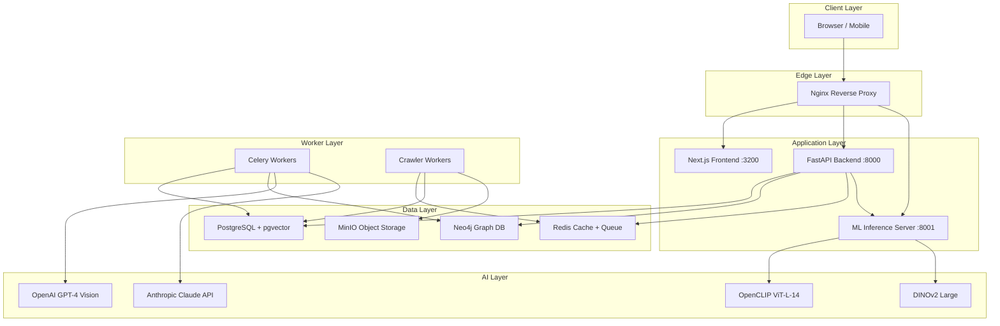
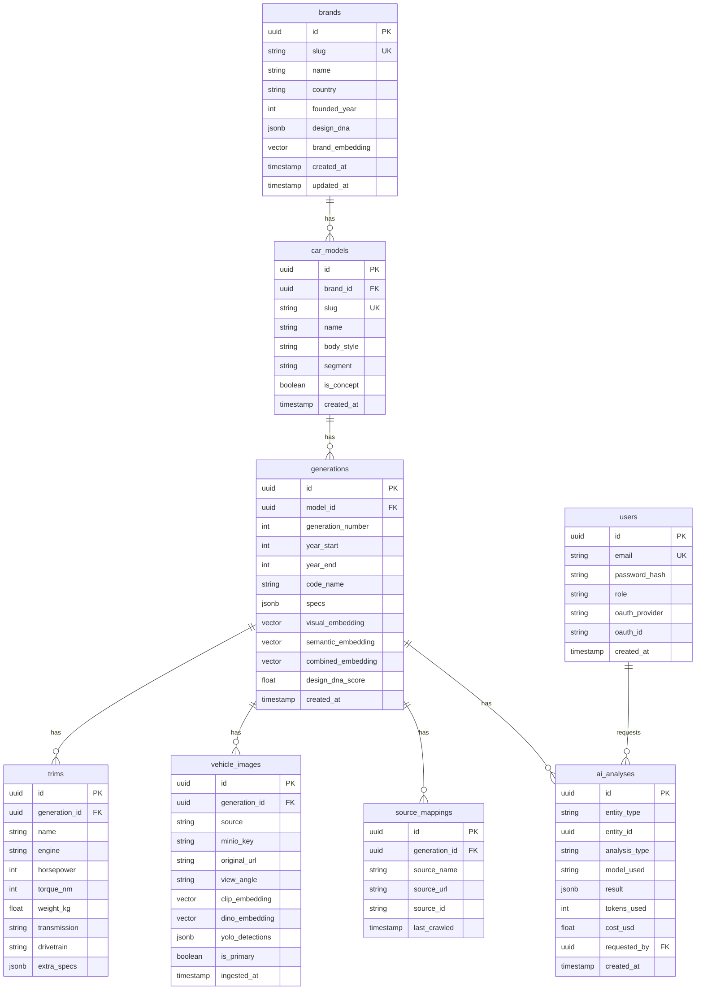
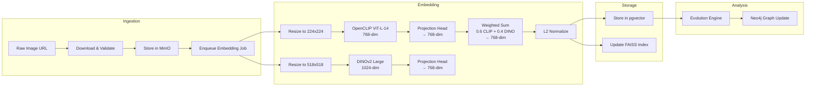

# Architecture

## System Overview

The AI Automotive Evolution Platform is a distributed, multi-tier system designed to ingest, analyze, and visualize the evolutionary lineage of automotive designs across brands and decades. It combines traditional relational storage with graph databases, vector similarity search, and multiple deep learning models to produce rich, queryable knowledge about how cars change over time.

The system is composed of six logical layers: Client, Edge, Application, Worker, Data, and AI. Each layer is independently scalable and communicates over well-defined interfaces.



---

## Component Descriptions

### FastAPI Backend

The FastAPI backend (port 8000) is the primary REST API gateway. It is implemented in Python 3.11 with async/await throughout, using SQLAlchemy 2.0 for PostgreSQL access, the official `neo4j` async driver for graph queries, and `redis.asyncio` for cache operations.

Key responsibilities:
- **Authentication and authorization** — JWT-based auth with RS256 signing, OAuth2 integration with Google and GitHub, and role-based access control (RBAC) with three tiers: `viewer`, `analyst`, and `admin`.
- **Request routing** — all `/api/v1/*` paths are served here. The backend validates inputs with Pydantic v2, enforces rate limits via Redis sliding-window counters, and delegates heavy computation to Celery workers.
- **Data aggregation** — multi-source queries that JOIN PostgreSQL relational data with Neo4j graph traversals, then merge results before responding. For example, a request for a model's evolution tree triggers both a Neo4j shortest-path query and a PostgreSQL fetch of generation metadata.
- **Cache management** — read-through caching using Redis with per-entity TTLs. Brand DNA analyses are cached for 24 hours; similarity search results for 5 minutes; static reference data (brands, body styles) for 1 hour.
- **WebSocket support** — crawler progress and analysis job status are streamed to the frontend over WebSocket connections managed by the backend.

The backend runs behind Nginx and is deployed as a Kubernetes Deployment with a minimum of 3 replicas and a Horizontal Pod Autoscaler that scales to 20 replicas based on CPU and request-rate metrics.

### ML Inference Server

The ML Inference Server (port 8001) is a dedicated FastAPI application that runs on GPU-enabled nodes. It owns all deep learning model lifecycle — loading, batching, and inference — to keep GPU memory allocation isolated from the main backend process.

Models loaded at startup:
- **OpenCLIP ViT-L-14** — 307M-parameter vision-language transformer producing 768-dimensional embeddings.
- **DINOv2 Large (ViT-L/14)** — self-supervised ViT producing 1024-dimensional CLS token embeddings, used for fine-grained part-level analysis.
- **YOLOv8x** — object detector adapted for automotive part segmentation (grille, headlights, door panels, wheel arches).
- **SAM (Segment Anything Model)** — used in conjunction with YOLO bounding boxes to produce pixel-level masks for each detected design element.

The inference server exposes a simple internal API:
- `POST /embed/image` — accepts base64 or presigned MinIO URL, returns `{clip: [...], dino: [...], combined: [...]}`.
- `POST /embed/batch` — processes up to 32 images in a single forward pass.
- `POST /detect/parts` — returns YOLO detections + SAM masks as polygon coordinates.
- `GET /health` — liveness and readiness probes.

All model weights are stored in a persistent volume mounted at `/models`. On startup, the server checks file hashes against a manifest and downloads any missing weights from the MinIO internal bucket.

### Neo4j Graph Database

Neo4j 5.x (Community or Enterprise) stores the evolutionary relationship graph. The choice of a graph database reflects the fundamentally relational nature of the problem: a car generation does not exist in isolation — it evolves from predecessors, shares platforms with siblings, and influences competitors.

The graph model is described in detail under [Neo4j Graph Model](#neo4j-graph-model) below. Queries use Cypher and are executed via the async Python driver. Complex graph analytics (PageRank for design influence scoring, community detection for brand clusters) are executed using the GDS (Graph Data Science) library.

Write access to Neo4j is exclusively through Celery workers to avoid concurrent write contention. The backend issues only read queries.

### Evolution Engine

The evolution engine is a Python module (`ml/evolution/engine.py`) that runs as a scheduled Celery task (every 6 hours for incremental updates, nightly for full recomputation). It:

1. Fetches all `(Brand, Generation, visual_embedding)` tuples from PostgreSQL.
2. Groups generations by brand and sorts by `year_start`.
3. Computes pairwise cosine similarity within each brand for consecutive generations, and cross-brand for overlapping time windows.
4. Applies thresholding rules (see [AI Pipeline — Evolution Detection](ai-pipeline.md)) to decide edge type.
5. Batch-writes edges to Neo4j using the `MERGE` pattern (idempotent upsert).
6. Publishes a `graph.updated` event to Redis Pub/Sub so the frontend can invalidate cached graph payloads.

The engine also computes a **Design DNA** fingerprint for each brand: a 20-element vector capturing recurring visual features (proportions, grille shape ratio, headlight curvature, etc.) aggregated across all generations weighted by recency.

### Crawler System

Six source-specific crawlers run as Celery workers, each tailored to a site's HTML structure. They are orchestrated by a scheduler that staggers runs to respect per-domain rate limits.

| Source | Data Coverage | Rate Limit | Notes |
|---|---|---|---|
| NetCarShow | ~50,000 images, specs | 1 req/2s | Primary high-resolution source |
| Caricos | ~30,000 images | 1 req/3s | Good coverage of rare models |
| Motor1 | Editorial content, launch dates | 2 req/s | Used for text/context, not images |
| AutoEvolution | Specs, engine families | 1 req/2s | Best source for powertrain data |
| Supercars.net | Supercar segment | 1 req/3s | Niche coverage, high image quality |
| ConceptCarz | Historical/concept cars | 1 req/5s | Vintage and concept coverage |

Each crawler:
1. Fetches paginated listing pages and extracts car model URLs into a Redis queue.
2. A pool of worker threads processes URL items: fetch page, parse HTML with BeautifulSoup/lxml, extract structured data.
3. Images are downloaded and stored in MinIO under `raw/{source}/{brand}/{model}/{filename}`.
4. Extracted metadata is upserted into PostgreSQL via SQLAlchemy bulk operations.
5. A post-processing step deduplicates images across sources using perceptual hashing (PHash, threshold d < 8).
6. New images trigger an ML embedding job via Celery.

Crawl state (last-seen URL, run timestamps, error counts) is persisted in a dedicated PostgreSQL `crawl_jobs` table, allowing resumable crawls after failures.

---

## Database Design

### PostgreSQL Schema

PostgreSQL 15 with the `pgvector` extension is the primary relational store. The schema is managed with Alembic migrations.



Vector columns use `pgvector` types:
- `visual_embedding` — 1536-dim (projected combined CLIP+DINO).
- `semantic_embedding` — 1536-dim (OpenAI `text-embedding-3-large`).
- `combined_embedding` — element-wise average of visual and semantic, used for multimodal search.

Indexes:
```sql
CREATE INDEX ON generations USING ivfflat (visual_embedding vector_cosine_ops) WITH (lists = 100);
CREATE INDEX ON generations USING ivfflat (combined_embedding vector_cosine_ops) WITH (lists = 100);
CREATE INDEX ON vehicle_images USING ivfflat (clip_embedding vector_cosine_ops) WITH (lists = 200);
```

### Neo4j Graph Model

```
Nodes
------
(:Brand)       { id, slug, name, country, founded_year }
(:Model)       { id, slug, name, body_style }
(:Generation)  { id, pg_id, year_start, year_end, code_name, design_dna_score }
(:Concept)     { id, slug, name, year_shown, show_name }
(:Designer)    { id, name, nationality, active_years }
(:Platform)    { id, name, manufacturer, year_introduced }
(:EngineFamily){ id, name, displacement_l, fuel_type }
(:BodyStyle)   { id, name }

Relationships
-------------
(:Generation)-[:EVOLVES_INTO { similarity: float, year_delta: int, confidence: float }]->(:Generation)
(:Generation)-[:FACELIFT_OF  { similarity: float, change_scope: string }]->(:Generation)
(:Generation)-[:INFLUENCED_BY { strength: float, aspect: string }]->(:Generation)
(:Generation)-[:SHARES_PLATFORM { from_year: int }]->(:Platform)
(:Generation)-[:DESIGNED_BY { lead: bool }]->(:Designer)
(:Concept)-[:CONCEPT_FOR { realization_pct: float }]->(:Generation)
(:Generation)-[:COMPETITOR_OF { segment_overlap: float }]->(:Generation)
(:Model)-[:BELONGS_TO]->(:Brand)
(:Generation)-[:INSTANCE_OF]->(:Model)
(:Generation)-[:HAS_BODY_STYLE]->(:BodyStyle)
(:Generation)-[:POWERED_BY]->(:EngineFamily)
```

Example Cypher query — find all models BMW influenced across brands within a 10-year window:

```cypher
MATCH (b:Brand {slug: 'bmw'})-[:BELONGS_TO]-(m:Model)-[:INSTANCE_OF]-(g:Generation)
MATCH (g)-[:INFLUENCED_BY*1..2]-(other:Generation)
WHERE other.year_start BETWEEN g.year_start - 10 AND g.year_start + 10
MATCH (other)-[:INSTANCE_OF]-(om:Model)-[:BELONGS_TO]-(ob:Brand)
WHERE ob.slug <> 'bmw'
RETURN ob.name AS influenced_brand, om.name AS influenced_model,
       other.year_start AS year, r.strength AS influence_strength
ORDER BY influence_strength DESC
```

---

## AI Pipeline Architecture



---

## Scalability

### Horizontal Scaling

**FastAPI workers** scale horizontally via Kubernetes HPA. The HPA watches average CPU utilization (target 60%) and custom metrics (requests-per-second via Prometheus adapter). Min replicas: 3; max: 20. Each pod is stateless — all state lives in PostgreSQL, Redis, or Neo4j.

**Celery workers** are split into four queues with separate worker pools:
- `embeddings` — GPU-bound, runs on GPU node pool, 2 workers per GPU.
- `analysis` — CPU-bound LLM API calls, up to 10 workers per node.
- `crawlers` — I/O-bound, up to 50 concurrent workers using gevent.
- `default` — general tasks, 5 workers.

**ML Inference Server** is deployed on a dedicated GPU node group. Multiple inference server pods can share a GPU using NVIDIA MPS or run on separate GPUs. Requests are load-balanced by Nginx.

### Database Scaling

**PostgreSQL** uses connection pooling via PgBouncer (transaction mode, max 200 connections). Read replicas handle read-heavy analytical queries. The pgvector IVFFlat index uses `lists = 100` for the current 100k-vector dataset; this should be re-tuned to `sqrt(n)` as the corpus grows.

**Neo4j** runs in standalone mode for datasets up to ~50M nodes. For larger deployments, Neo4j Cluster (3 nodes: 1 primary, 2 secondaries) provides read scalability and HA. Graph analytics (GDS) should be scheduled during off-peak hours as they are memory-intensive.

**Redis** is deployed as a Redis Cluster (3 primaries, 3 replicas) using hash slots for data distribution. The cache and the job queue use separate logical databases (db0 for cache, db1 for Celery).

### Storage Scaling

MinIO is deployed in Distributed mode across 4 nodes with erasure coding (2 data + 2 parity). It provides S3-compatible APIs and horizontal scaling by adding more nodes to the pool. Images are stored with per-source bucket policies and lifecycle rules that move images older than 1 year to a cold storage tier.

### Vector Search Performance

For datasets up to ~500k vectors, `pgvector` with IVFFlat provides acceptable latency (~45ms p99). For higher performance at scale, a FAISS in-memory index is maintained in the ML Inference Server, rebuilt nightly from PostgreSQL, providing ~2ms ANN search. The two can be used in combination: FAISS for the hot path (top-10 approximate results), pgvector for exact re-ranking.
